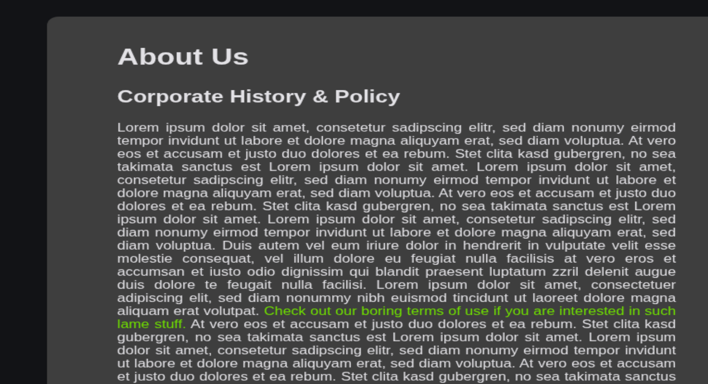
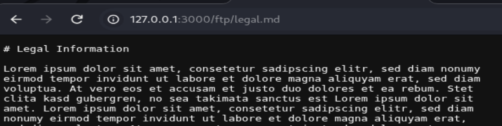
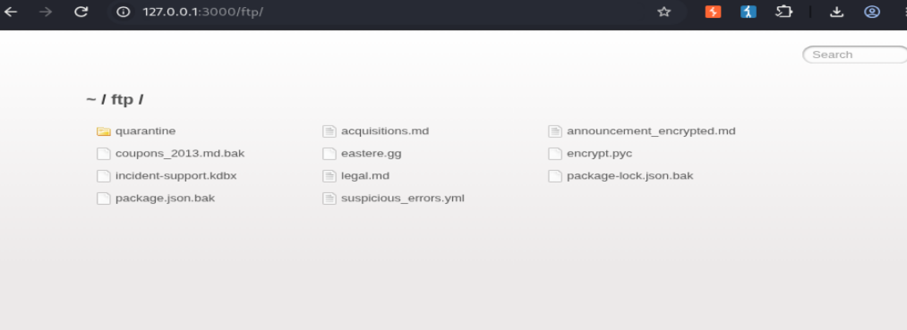
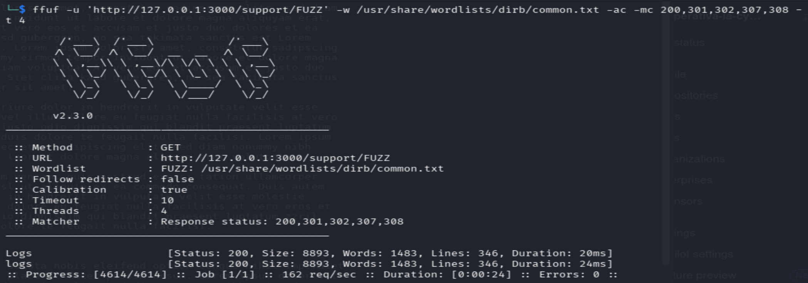

#F01 - Unauthorised Access to access.log.2026-11-05

##Summary

I identified that the web-accessible 'access.log' file could be retrieved
without authentication or authorization.
The exposed 'access.log' file disclosed HTTP request metadata, including request
timestamps, requested paths, response status codes, the requester’s internal
Docker-network address, and browser user-agent information.
This information could help an
unauthorized user enumerate application routes and support further
reconnaissance.

---

##Severity

Not required

---

##Affected component

Publicly accessible access.log.2026-11-05 file (http://localhost:3000/support/logs)  

---

##Classification

OWASP Top 10:2025 A01 — Broken Access Control

CWE-552 — Files or Directories Accessible to External Parties

---

##Discovery

While reviewing the **About Us** page (localhost:3000/#/about), I followed a legal-policy link and observed
that it was hosted under the /ftp/ directory (localhost:3000/ftp/legal.md).
Within that directory, I noticed a file named 'incident-support.kdbx',
which indicated that the application may contain support-related resources.

As part of the authorised assessment, I used 'ffuf' to enumerate directories
from the application root and identified a '/support/logs' directory. 

Accessing the discovered resource without authentication returned the
'access.log' file. The file exposed HTTP request metadata, confirming that the
log was accessible to an unauthorised user.

---

## Steps to Reproduce

1. Navigate to the publicly accessible http://localhost:3000/ftp/ directory.

2. Observe the file named 'incident-support.kdbx'.

(see the image above)

3. Based on this filename, use ffuf to enumerate resources under the candidate
   '/support/' path:

4. 2 logs directory founded, one of them lead to the log file: access.log.2026-11-05

(see the image above)

---

## Evidence

The screenshots included in the discovery and reproduction sections demonstrate:

- the 'incident-support.kdbx' file exposed in '/ftp/';
- ffuf identifying the '/support/logs' directory; and
- unauthenticated access to the 'access.log' file.

---

## Impact

**Confidentiality:** An unauthenticated user can access the server access log.
The reviewed entries expose HTTP request metadata, including request paths,
timestamps, response status codes, internal network information, and browser
user-agent details. This information may help an attacker map the application's
attack surface.

**Integrity and availability:** Not assessed. The scope of this finding was
limited to unauthorised read access to the log file.

**Affected users/data:** The log may contain information about users' requests
and application behaviour. If it contains credentials, session tokens, personal
data, or sensitive URLs, the impact would be higher.

---

## Remediation

1. Remove 'access.log`' and all operational log files from web-accessible
   directories. Store logs outside the application’s public web root and do not
   expose them through '/support/logs'.

2. If authorised staff must view logs through the application, enforce
   server-side authentication and role-based authorization. Access should be
   denied by default to unauthenticated users.

3. Disable directory listings for sensitive paths and add a regression test
   confirming that unauthenticated requests to '/support/logs' and log files
   receive '403 Forbidden' or '404 Not Found'. Monitor and alert on attempted
   unauthorized access to log resources.

---

## References

- OWASP Top 10:2025 A01 - Broken Access Control: https://top10.owasp.org/2025/A01_2025-Broken_Access_Control
- CWE-552 — Files or Directories Accessible to External Parties: https://cwe.mitre.org/data/definitions/552.html
- OWASP Logging Cheat Sheet: https://cheatsheetseries.owasp.org/cheatsheets/Logging_Cheat_Sheet.html

---

##Learning outcomes

- Practiced web-content discovery with 'ffuf' in an authorized lab environment.
- Learned to use contextual clues, such as filenames, to form and test route hypotheses.
- Validated unauthenticated access to a sensitive application resource.
- Documented the finding with evidence, impact, remediation, and recognized security classifications.
